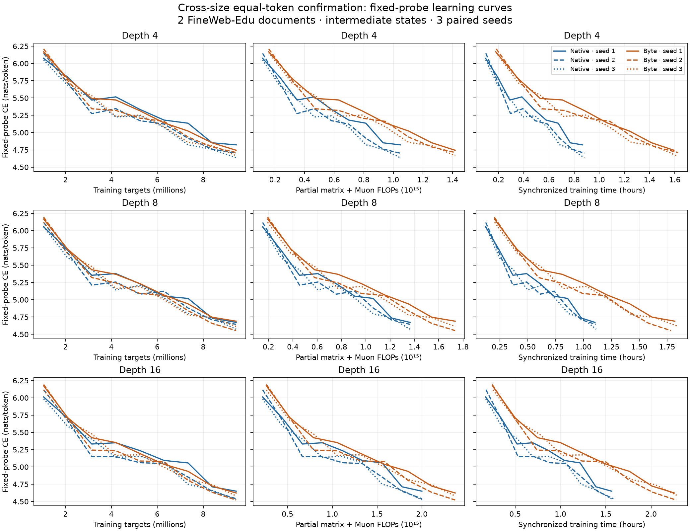

# Cross-size equal-token quality results

All18 frozen runs and execution reviews are complete. The byte-input benefit transfers from depth4 to depth8 under the frozen quality rule. Depth16 is unresolved. The predefined interaction confirms that the byte advantage weakens from depth4 to depth16. All36 RAW/H200 endpoints and432 first outputs are retained. The original test remains unopened.

## Frozen primary decision

Differences are byte minus native H200 development CE in nats/token. Negative favors byte. Each interval is a99.75% paired document-bootstrap interval, using100,000 resamples and the frozen seed. Four contrasts use Bonferroni control at1% family error. These intervals are conditional on three training seeds and108 development documents. They do not estimate population-seed uncertainty or independent test performance.

| Contrast | Three paired deltas | Mean | 99.75% interval | Frozen decision |
| --- | --- | ---: | --- | --- |
| delta4 | -0.049465, -0.061118, -0.040423 | -0.050335 | [-0.068858, -0.034100] | byte_superior |
| delta8 | -0.018120, -0.030495, -0.032900 | -0.027171 | [-0.045834, -0.010145] | byte_superior |
| delta16 | -0.013540, +0.006673, +0.001171 | -0.001899 | [-0.019631, +0.013992] | unresolved |
| delta16_minus_delta4 | +0.035925, +0.067791, +0.041594 | +0.048436 | [+0.037385, +0.058241] | byte_advantage_weakens |

Depth4 and depth8 pass every-seed sign, mean improvement>=0.02, interval and source-regression criteria. Their FineWeb-Edu/Wikipedia mean differences are−0.046334/−0.066361 and−0.022819/−0.044602 respectively. Depth16 has mixed seed signs and an interval spanning zero. That is unresolved, not equivalence or evidence that native is superior.

The16-minus4 interaction is+0.048436, with all three interactions positive and the interval entirely above zero. This directly tests change in the paired effect. It is not inferred from separate significance tests. RAW endpoint mean differences are−0.048023,−0.025950 and−0.000903 at depths4/8/16. RAW remains descriptive.

## Parameter and runtime tradeoff

| Depth | Native parameters | Byte parameters | Parameter saving | Byte/native training-time ratios | Geometric mean |
| ---: | ---: | ---: | ---: | --- | ---: |
| 4 | 28,492,416 | 16,351,859 | 42.61% | 1.8404×, 1.8448×, 1.8342× | 1.8398× |
| 8 | 31,252,736 | 19,112,179 | 38.85% | 1.6480×, 1.6032×, 1.6511× | 1.6340× |
| 16 | 36,773,376 | 24,632,819 | 33.01% | 1.4407×, 1.4407×, 1.4559× | 1.4458× |

The depth16/depth4 runtime-penalty ratios are0.782845, 0.780989, 0.793756, with geometric mean0.785843. All are below1 and their geometric mean is below0.9, meeting the frozen descriptive dilution criterion. Byte still costs more training time at every tested size. Parameter totals derive from the qualified tensor inventory; body width, tokenizer and output vocabulary stay fixed.

| Depth and arm | Median update seconds after warmup, seeds1/2/3 | Peak RSS bytes | Peak MPS bytes |
| --- | --- | ---: | ---: |
| 4 native | 0.327409, 0.332487, 0.331650 | 1021296640 | 2512175104 |
| 4 raw_bytes | 0.619011, 0.630495, 0.627061 | 1274052608 | 3640442880 |
| 8 native | 0.413933, 0.431248, 0.429305 | 965607424 | 2587672576 |
| 8 raw_bytes | 0.702340, 0.692624, 0.720561 | 1412317184 | 3724328960 |
| 16 native | 0.611591, 0.615913, 0.614566 | 1046921216 | 2747056128 |
| 16 raw_bytes | 0.870048, 0.870913, 0.892303 | 1523236864 | 3975987200 |

Warmup exclusion is a posthoc descriptive choice: first128updates. Full runtime totals include every update. Individual log-ratios and all per-run costs are in `descriptive-results.json`.

## Broader probe

This is the frozen dataset002 probe of eight PG19 books and eight Python prose parents. Each domain contributes16,384 targets per seed. Table intervals are descriptive95% paired parent bootstraps, conditional on the three seeds. Every seed/parent and both endpoints are retained in `descriptive-results.json`.

| Depth | Endpoint | Domain | Byte-minus-native mean | 95% interval |
| ---: | --- | --- | ---: | --- |
| 4 | raw | pg19_books | -0.124600 | [-0.228902, -0.016600] |
| 4 | h200 | pg19_books | -0.105502 | [-0.204825, +0.011604] |
| 8 | raw | pg19_books | -0.112898 | [-0.216563, -0.011343] |
| 8 | h200 | pg19_books | -0.093037 | [-0.195666, +0.017655] |
| 16 | raw | pg19_books | -0.038539 | [-0.129444, +0.085154] |
| 16 | h200 | pg19_books | -0.028308 | [-0.123478, +0.104652] |
| 4 | raw | python_library_prose | -0.140395 | [-0.161303, -0.119264] |
| 4 | h200 | python_library_prose | -0.143595 | [-0.164693, -0.122805] |
| 8 | raw | python_library_prose | -0.111360 | [-0.135492, -0.083187] |
| 8 | h200 | python_library_prose | -0.115638 | [-0.138539, -0.088036] |
| 16 | raw | python_library_prose | -0.061944 | [-0.082365, -0.039649] |
| 16 | h200 | python_library_prose | -0.060526 | [-0.080562, -0.038717] |

Python prose favors byte in all seeds at every size and all displayed intervals exclude zero. H200 book intervals include zero at every size; RAW books exclude zero at depths4/8 only. These narrow findings do not establish broad-domain superiority and do not change the primary gates. Artificial Python paragraph joins, only eight parents per domain, and exact-span exclusion that misses paraphrases limit applicability. Older format-sensitive transfer results stay closed and are not pooled.

## First-generation evaluation

All432 retained first outputs were rated once using the frozen relevance/consistency rubric. Arm, depth, seed bundle and checkpoint labels were removed; rows were shuffled with the frozen seed and mapping saved separately. The primary agent had seen aggregate losses and one identified slot17 completion during schema inspection before rating. Presentation hid identities but the rater was neither independent nor completely unexposed. Ratings are exploratory; consistency is not exhaustive factual accuracy. No rerolls or composite CE/generation gate were used.

| Depth / arm | Decoder | Relevance mean | Consistency prompt mean | Consistency unassessable | Terminal loops /36 | Trigram repetition | Mean length | EOS /36 |
| --- | --- | ---: | ---: | ---: | ---: | ---: | ---: | ---: |
| depth4_native | greedy | 0.750 | 0.806 | 4 | 14 | 0.518 | 64.00 | 0 |
| depth4_native | temp.8/top-k40 | 0.833 | 0.917 | 0 | 0 | 0.016 | 60.86 | 3 |
| depth4_raw_bytes | greedy | 0.833 | 0.903 | 1 | 17 | 0.536 | 64.00 | 0 |
| depth4_raw_bytes | temp.8/top-k40 | 0.750 | 0.875 | 1 | 0 | 0.027 | 61.97 | 3 |
| depth8_native | greedy | 1.083 | 0.792 | 3 | 13 | 0.542 | 64.00 | 0 |
| depth8_native | temp.8/top-k40 | 0.750 | 0.778 | 2 | 0 | 0.020 | 62.83 | 2 |
| depth8_raw_bytes | greedy | 0.722 | 0.708 | 5 | 12 | 0.547 | 64.00 | 0 |
| depth8_raw_bytes | temp.8/top-k40 | 0.833 | 0.903 | 2 | 0 | 0.019 | 64.00 | 0 |
| depth16_native | greedy | 1.083 | 0.986 | 2 | 15 | 0.584 | 64.00 | 0 |
| depth16_native | temp.8/top-k40 | 0.972 | 0.778 | 0 | 0 | 0.010 | 60.17 | 4 |
| depth16_raw_bytes | greedy | 0.806 | 0.750 | 2 | 18 | 0.541 | 64.00 | 0 |
| depth16_raw_bytes | temp.8/top-k40 | 0.833 | 1.000 | 0 | 0 | 0.022 | 63.81 | 1 |

Greedy outputs all hit64tokens and often loop. Byte/native loop counts are17/14 at depth4,12/13 at depth8, and18/15 at depth16. Sampled outputs have no measured terminal loops, but topic drift and contradictions remain. Byte has no consistent semantic-rating advantage across sizes and decoders. CE superiority must not be described as fluent or reliable generation. Full ordinal counts, per-seed summaries, unassessable fractions, truncation rates, quotes and reasons are retained in `generation-evaluation/`.

## Learning curves and accounting

Curves use the same two FineWeb-Edu documents at the frozen intermediate steps. They compare targets, partial operator FLOPs and synchronized training time. They are not final-H200 or full-development curves. The limited probe suggests native reaches similar intermediate loss sooner, even where terminal equal-token byte CE wins. Different points have different schedule progress; these curves do not replace a fresh equal-time contrast.

Each run executes10,485,760 targets across10,240 updates, for188,743,680 scientific targets. Training time totals111255.029seconds (30.904hours). Scientific worker guards total116697.306seconds (32.416hours), including endpoint scoring, generation and serialization. Recorded engineering adds467.458seconds. There are no failed or replayed scientific updates. Prelaunch receipt/guard failures started no training and remain separately preserved.

The accounted dense forward/backward and Muon matrix estimate totals33,123,796,539,371,520 FLOPs. It excludes norms, activations, CE, lookup/scatter, AdamW, clipping, averaging, reductions, I/O and evaluation. It is not total hardware work or6NT. All future/serialization/failure allowances and12GiB reserve/headroom were admitted before each run. No partial panel or weakened gate was used.

## Learning and next action

Measured: byte saves fewer parameters and incurs a smaller relative runtime penalty as the fixed-width body grows. Its equal-token development advantage transfers to depth8 but weakens substantially by depth16. Inference: fixed input-module costs become less important relative to body work. The quality interaction does not isolate whether the cause is representational dilution, unchanged hyperparameters, finite-token exposure or schedule behavior. It is not a scaling law.

Next executable action is a bounded existing-data attribution of the completed size interaction: use all108 paired development-document losses and the retained probe/training curves to determine whether weakening is concentrated in one source or a few documents and whether it appears before the shared cooldown. Treat it as posthoc diagnosis, with no new acceptance gate. Then use evidence-grounded-research to rank a single next cross-size hypothesis against the completed context-length finding, grounding any proposed training in primary literature and a new full-resource contract. No new training is selected by this report. Preserve the closed panels and existing adopted recipes.

Evidence: `tokenizer-evidence/general-rsi-cross-size-quality-001/decision.json`, `descriptive-results.json`, `generation-evaluation/summary.json`, `probe-curves.json`, and `completion-review.json`.
