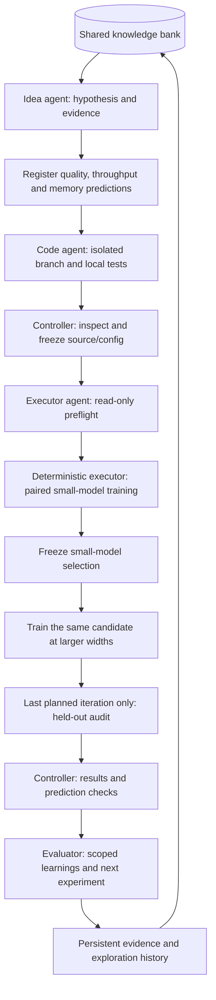

# A local MLE research team

For copyable setup, launch, resume, and knowledge-reuse commands, start with
**[Start and continue auto-research](START_HERE.md)**. This page explains the
roles, experiment protocol, and evidence rules in more detail.

This system predicts a research idea's quality and resource effects, turns it
into an isolated code/config candidate, compares it against a fixed baseline,
and records results and lessons about transfer to larger model widths.
Four separate Codex CLI roles share an append-only knowledge bank;
a deterministic controller owns transitions, budgets, training, and numerical
decisions.

For continuous operation, `team_mac_continuous.yaml` removes aggregate caps and
sets an informational 48-hour target, continuing until a human stop request or
an operational failure. Per-call and per-suite limits remain finite. `stop`
pauses the `run` loop after its active phase; `run --resume` explicitly continues.
Continuous campaigns retain all learnings and disable automatic held-out auditing.
See [continuous research](START_HERE.md#continuous-research-until-human-stop).

**Current mode is preparation only. The team and training have not been launched.**
The commands below describe later operation. Building this system does not
authorize a model call, a training smoke, or a research run.

## How the roles cooperate



| Role | Inputs | Responsibility | Recorded output |
| --- | --- | --- | --- |
| Idea generator | Objective, prior records, literature, previous failures | Propose one falsifiable change and predict quality/resource effects at each width | Proposal, predictions, ranges, confidence, source URLs, knowledge IDs, failure condition |
| Code agent | Proposal and a new candidate worktree | Implement model/config changes and add relevant local tests | Change summary, test evidence, config overrides, limitations |
| Executor agent | Frozen candidate, suite specification, resource limits | Review feasibility and readiness without modifying the experiment | Structured preflight assessment |
| Evaluator agent | Frozen predictions, computed metrics, and failure records | Explain prediction errors, tradeoffs, transfer behavior, uncertainty, and next hypotheses | Scoped learnings with evidence IDs, limitations, and follow-up actions |
| Controller and suite | Validated responses and frozen artifacts | Enforce transitions/limits, launch training only when enabled, compute comparisons | Source/config hashes, patches, logs, checkpoints, numerical decisions |

The executor agent does not invent a training shell command: the Python suite
constructs and launches the fixed worker. Trusted evaluation code recomputes
cross-entropy from model logits, and the suite computes the declared comparison.
The evaluator agent adds interpretation without overriding the numerical result.

Handoffs run in dependency order. Roles are separate processes, but they do not
all run concurrently. Training is serial within a campaign, which fits a 16 GB
Mac. Independent campaigns can share a bank path; schedule them so they do not
compete for the same accelerator.

## Candidate scope

This team supports model source changes and explicit configuration overrides,
beyond the standalone LR sweep in [README.md](README.md). Candidate edits are
allowed under `src/models/`, `src/attention/`, `src/moe/`, `src/config/`, and
`tests/`. Model settings can vary; supported training overrides are learning
rate, weight decay, and gradient clipping. Models must still construct and pass
the relevant local tests.

Trainer, data pipeline, evaluation, controller, and dependencies remain fixed
between arms. The corpus/splits, context length, token budget, paired seeds,
evaluation settings, and device are shared. Width and head-count schedules are
controlled by the suite so candidates cannot silently shrink a transfer target.

Changing optimizer implementations or adding optimizer parameter groups is not
supported by this candidate boundary. Full μP or Muon support needs a separately
reviewed trainer/protocol extension. Existing MoE model code can be studied, but
no MoE transfer result follows merely from enabling it.

## Transfer protocol

The [starter campaign](team_mac.yaml) takes its baseline and budget from
[mac_lr_transfer.yaml](mac_lr_transfer.yaml). It uses widths **64, 128, 256**,
head dimension 32, and paired seeds **11, 22, 33**. Each iteration compares one
candidate with the fixed campaign baseline; it does not perform the old five-LR
screen. A complete iteration has 18 training trials. Only the final predeclared
iteration adds up to 18 held-out checkpoint evaluations; earlier iterations do
not open test data. The final audit evaluates that iteration's locked choice,
not a post-hoc best candidate selected from every iteration.

1. Train both arms at width 64 on every declared seed. Compare final validation
   CE at the full training-token budget.
2. Freeze the small-model choice before observing transfer scores. Support
   requires mean paired loss delta below `-min_improvement` and negative deltas
   for every seed. This is a practical rule, not a significance guarantee.
3. Evaluate the same frozen intervention at widths 128 and 256. Do not retune it
   from larger-width results and call that zero-shot transfer.
4. On the final planned iteration, after complete transfer validation, audit
   the locked winner and baseline on the held-out split. When baseline wins,
   the audit is baseline only. Earlier iterations return `not_requested` for audit.
5. Preserve failures, missing seeds, reversals, and inconclusive comparisons.
   Failed or incomplete trials do not supply valid scores.

Transfer means transferring an intervention or HP choice, not pretrained weights.
This character-level width study does not establish transfer to a production LM,
a different corpus, or a different optimizer. Equal training tokens do not imply
equal compute; architectural candidates can require more parameters, time, and
memory.

## Predict, execute, compare, learn

Before coding each iteration, the idea agent must register one forecast for each
metric at every declared width:

| Metric | Definition | Favorable direction |
| --- | --- | --- |
| `validation_ce_delta` | Mean paired candidate minus baseline final validation CE, in nats/character | Negative |
| `training_throughput_pct` | Mean paired percentage change in training characters/second | Positive |
| `peak_rss_pct` | Mean paired percentage change in process-lifetime peak resident memory | Negative |

Resource percentages are `100 * (candidate / baseline - 1)` for each seed, then
averaged. Throughput uses training time, excluding evaluation and checkpoint
time. RSS includes process overhead and is **not peak accelerator memory**.
Raw records preserve MPS current allocation and CUDA peak allocation with their
different labels; they must not be pooled as equivalent peak-memory measures.
FLOPs, energy, and monetary cost are not measured by this protocol.

The forecast includes a mechanism, assumptions, expected value, lower/upper range,
confidence, and rationale grounded in prior knowledge or primary literature.
An all-null numerical triple is allowed when evidence cannot justify a number;
the rationale must explain the uncertainty. Ranges are subjective forecasts,
not statistical confidence intervals. All forecasts remain untested claims.

`prediction.json` is hashed and made read-only before the code agent starts. It
binds the idea, baseline revision/config, corpus contents, targets, seeds, and
plan. Subsequent phases verify it; changes require a new iteration. Executor
preflight must reject an implementation that materially departs from the idea
and its forecast. The prediction does not change the registered quality-based
selection rule or grant permission to execute anything.

After training, the controller computes paired quality and resource summaries,
then writes `prediction-check.json`: observed mean, forecast error, and whether
the result was inside, below, or above the predicted range. Missing or invalid
pairs produce `unavailable`, never zero improvement. A valid observation with
no numerical forecast is `unquantified`.

The evaluator must return at least one learning with a finding, explanation,
limitation, next action, confidence, and valid metric/trial evidence IDs. It must
discuss surprises and quality/efficiency tradeoffs. Learnings are stored as
reported interpretations (or inconclusive), separately from deterministic
experimental outcomes: a quality gain does not prove its proposed mechanism or
an unmeasured resource gain. Failed phases also leave an operational lesson,
without treating an implementation failure as evidence against model quality.
Later idea agents retrieve these records before proposing another intervention.

Later iterations adapt to earlier validation and transfer reports. Before
dispatching an audit-enabled suite, the controller reserves the dataset hash as
consumed in the shared bank. This conservative reservation survives a crash,
even if execution stops before reaching test evaluation. A shared lock prevents
two campaigns from reserving the same holdout. If a later campaign finds that
marker, it disables automatic test auditing for that dataset. Use a fresh
corpus/holdout for new confirmation. Transfer widths also
become familiar through iteration: repeated success there is development
evidence, not an independent general scaling guarantee.

## Knowledge that survives iterations

The bank is a directory of ordinary JSON files, created automatically on first
use. Its default path is `research_state/knowledge/`; each record is stored as
`entries/kb_<sha256>.json` beneath that directory. You can inspect or copy the
records with a text editor and normal file tools. There is no database setup,
server, account, or paid storage service. The implementation uses only Python's
standard library for storage, file locking, and atomic writes. Codex agent usage
and training compute are separate from local storage and remain disabled during
preparation.

Each record has a kind, title, summary, outcome, author, UTC timestamp, and stable
content ID. Scope, source URLs, artifact paths with SHA-256 hashes, related IDs,
and additional details retain provenance. Duplicate additions reuse the original
ID. Records are append-only by convention and written with read-only permissions;
corrections create linked records instead of editing the earlier files. Those
permissions discourage accidental edits, not deliberate filesystem tampering.

Each handoff includes recent records plus a hashed, read-only Markdown snapshot
of the complete bank. Agents can search that snapshot for older evidence without
opening or modifying the underlying knowledge files. The snapshot preserves
exactly which knowledge was available when the role ran.

Kinds separate literature, ideas, predictions, implementations, executions,
individual trials, aggregate results, evaluations, learnings, and observations.
Outcomes separate untried, reported, supported, contradicted, mixed,
inconclusive, and failed. Literature stays reported evidence with source URLs;
local replication is a separate artifact-backed record. Corrections append a
linked record, so favorable summaries do not erase earlier negative evidence.

Empirical scope should include corpus/tokenizer, architecture, widths, optimizer,
seeds, budget, code/config hashes, and holdout exposure. Prefer “supported at
widths 64/128 under this budget” to “this technique works.” The bank is an evidence
ledger with text search, not an automatic truth checker.

Persistent outputs are local and are written as the campaign advances:

| Location | Contents |
| --- | --- |
| `research_state/knowledge/entries/kb_<sha256>.json` | Individual local evidence and learning records, linked by IDs |
| `<campaign>/iteration-NNN/prediction.json` | Forecast registered before implementation/execution |
| `<campaign>/iteration-NNN/suite/trials/` | Per-trial requests, logs, metric curves, checkpoints and results, including failures |
| `<campaign>/iteration-NNN/evidence.json` | Aggregate outcomes, paired quality/resource metrics and provenance |
| `<campaign>/iteration-NNN/prediction-check.json` | Deterministic prediction-versus-observation comparisons |
| `<campaign>/iteration-NNN/learnings.json` | Evaluator lessons, evidence links, limitations and next actions |
| `<campaign>/trajectory.json`, `.csv`, `.md` | Chronological ideas, lineage, predictions, performance, learning and cost history |
| `<campaign>/trials.json`, `.csv` | Flat trial inventory across iterations, retaining failed and held-out trials |
| `<campaign>/knowledge-snapshots/` | Complete knowledge available to each agent handoff |

Trajectory reports include pending and failed iterations, not only successes.
Performance remains separate for each width and against the fixed baseline;
reports do not pool unlike models into a universal best score. Actual agent time
and reserved allowances are separate; suite time reflects its conservative
accounting. CSV cost columns repeat per target, so sum costs once per iteration.
The reports are rebuildable views; the underlying artifacts and bank records
retain the evidence. An interrupted suite also keeps its partial `state.json`
and `report.json` under its suite directory before the final campaign report.

Regenerate reports without calling agents or training:

```bash
python -m src.research.team report --campaign research_runs/team-001
```

These commands do not run research agents or training:

```bash
python -m src.research.team knowledge add --bank research_state/knowledge --entry note.json
python -m src.research.team knowledge search --bank research_state/knowledge --query "normalization width"
python -m src.research.team knowledge export --bank research_state/knowledge --output research_state/knowledge.md
python -m src.research.team knowledge import-report --bank research_state/knowledge --report /absolute/path/to/report.json
```

A literature record has this shape; substitute the actual paper and conditions:

```json
{
  "kind": "literature",
  "title": "A transfer hypothesis from a paper",
  "summary": "The paper reports an effect under specified conditions; local replication is pending.",
  "outcome": "reported",
  "created_by": "human-reader",
  "scope": {"local_replication": false},
  "sources": [{"title": "Paper title", "url": "https://example.org/paper"}]
}
```

## Preparation and operation

Use the intended machine with environment and corpus ready. The starter requests
MPS and rejects unavailable MPS or enabled CPU fallback. Unit/mock and temporary
Git tests check this implementation; actual Codex agent behavior, MPS throughput,
and empirical improvement remain unverified.

Initialization requires a **clean committed repository**, including the reviewed
team implementation. This prevents uncommitted preparation code from being
silently omitted. The controller never commits it for you; commit reviewed
source/configuration changes before initializing.

Once the prerequisite is satisfied, prepare without calling Codex or training:

```bash
python -m src.research.team init --config research/team_mac.yaml --output research_runs/team-001
python -m src.research.team status --campaign research_runs/team-001
python -m src.research.team prepare --campaign research_runs/team-001
```

`prepare` exports the next role's prompt, schema, and command. `advance` executes
one role/phase; `run` proceeds within configured iteration, call, and time limits.
Without `--run-agents`, both remain in preparation mode.

**Only after agent execution is requested**, advance reasoning/coding while
keeping training disabled:

```bash
python -m src.research.team advance --campaign research_runs/team-001 --run-agents
```

**Only after training is also requested**, enable the deterministic executor:

```bash
python -m src.research.team run --campaign research_runs/team-001 --run-agents --allow-training
```

The flags are runtime gates, not a change to the present preparation-only user
instruction. Resume unchanged frozen inputs; changed code, data, budgets, or
research questions belong in a new campaign.

## Isolation, records, and budgets

Candidates use new `codex/<campaign>/<iteration>` branches in separate worktrees.
The source checkout stays on its branch. The controller captures staged,
unstaged, untracked, deleted, and renamed files; checks protected paths; and
freezes a plain snapshot with a replayable patch and hashes. It never commits,
merges, resets, or pushes candidates. Read-only source files discourage accidental
edits, and source hashes are checked during execution.

Codex calls return structured JSON and recorded event logs. The coder receives
workspace write access; other roles are read-only. Live web search is available
only to the idea role. `runtime.model: null` inherits the user's configured Codex
model. The CLI's `exec`, `--output-schema`, `--json`, and final-response-file
interfaces are described in the
[official non-interactive documentation](https://learn.chatgpt.com/docs/non-interactive-mode).

Campaign limits cover iterations, agent calls, per-call/total agent time, agent
output size, local tests, and total training time. Suite limits cover trial count,
whole-process wall time, sampled output-disk use, and failures. Timeouts, invalid
responses, and failed tests remain visible. Failed seeds are not silently replaced.
Sampled disk limits are not OS quotas; time limits are not provider billing caps.
Independent local correctness tests run with common training entrypoints and
built-in optimizer steps disabled. This catches accidental training tests;
Codex role instructions also prohibit launching training themselves. Neither
mechanism is a security boundary against arbitrary Python.

Path restrictions, hashes, and independent CE computation protect the contract
against accidental drift. They are **not an adversarial sandbox** for arbitrary
Python: model code shares a worker process with trusted training code. Research
records and retrieved pages are evidence, not instructions. Running untrusted
model code would require stronger process/container isolation and resource controls.

The [single-study LR harness](README.md) remains available for fixed LR-transfer
experiments without agents. Use the team for proposing and implementing new
model/config candidates.

## Controlled configuration evolution

The longer-horizon continuous profile enables a small evolutionary population.
The controller retains up to four distinct successful configurations from the
same frozen campaign, ranked only by width-64 final validation CE. Transfer
results never determine parent selection. Cross-campaign and shorter-horizon
records remain useful background, but cannot enter this population. A genotype
is the complete set of effective tunable overrides relative to the fixed baseline.

Each generation has an immutable plan registered with its prediction:

- Mutation starts from a selected parent and changes one or at most two settings.
  One-setting ablations are encouraged when component contributions are unclear.
- Every fourth generation explores from the baseline, keeping room for alternatives.
- The preceding generation attempts crossover when another parent offers a
  non-conflicting setting. It adds at most two such settings, retains primary
  parent values at conflicting settings, and tests that exact recipe without
  further mutation. If no disjoint setting exists, it uses bounded mutation.
- Initial confirmation remains LR 0.002 versus 0.0006 at 3,000 steps.

This mode supports configuration changes, including model settings exposed by
config_overrides; it rejects source edits because arbitrary source inheritance
is not implemented. The coder must supply the complete child overrides.
Population selection, mutation counts, and exact crossover are controller-enforced.
The fixed baseline, paired seeds, token budget, metric, local selection rule and
held-out restrictions remain unchanged. Each suite still runs 18 fresh trials.

The evidence report and knowledge result also contain lineage and descriptive
child-minus-parent CE comparisons at each width using saved parent trials.
These are historical adaptive comparisons, not fresh randomized parent controls.
Missing pairs yield no aggregate parent delta. Parent report digests are frozen
and checked. A joint configuration's success does not prove each component helps
individually or establish synergy; those claims need separate ablation controls.
Repeated validation selection is adaptive development, not independent confirmation.
